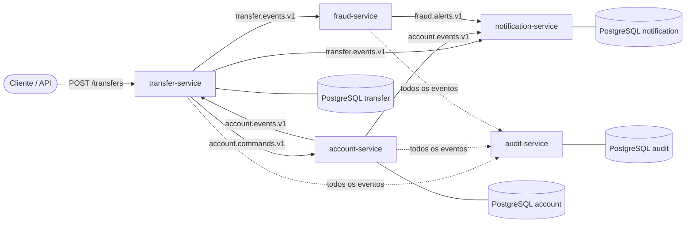

# Kafka Banking: Plataforma Bancária Event-Driven

Projeto de portfólio para aprender **Apache Kafka** com **Java 21 + Spring Boot 3** resolvendo problemas reais de um sistema bancário: consistência entre banco e broker, idempotência, transações distribuídas (Saga), detecção de fraude em tempo real e auditoria imutável.

> **Objetivo principal:** aprender Kafka de forma profunda. O domínio bancário foi escolhido porque *exige* as garantias que o Kafka oferece (ordem, durabilidade, replay) e porque erros aqui têm consequência real (débito duplicado, dinheiro perdido).

---

## 1. Visão geral da arquitetura



### Serviços

| Serviço | Responsabilidade | Principais conceitos de Kafka | Fase |
|---|---|---|---|
| [account-service](./account-service) | Contas, saldo, ledger, bloqueios | Producer, chave de partição, Outbox, consumer idempotente | 1 a 4 |
| [transfer-service](./transfer-service) | Orquestra a transferência (Saga) | Saga orquestrada, máquina de estados, compensação, timeouts | 1 a 4 |
| [notification-service](./notification-service) | Envia e-mail/SMS/push | Consumer group, retry não bloqueante, DLT | 2 |
| [fraud-service](./fraud-service) | Detecta comportamento suspeito | Kafka Streams, janelas, KTable, state store | 5 |
| [audit-service](./audit-service) | Trilha de auditoria imutável | Replay, offsets, consumer group independente, retenção | 5 |

> **Dica de escopo:** comece só com `account`, `transfer` e `notification`. Adicione `fraud` e `audit` depois que a Saga estiver estável e testada.

---

## 2. Catálogo de tópicos

Convenção de nome: `<domínio>.<tipo>.v<versão>` (ex.: `account.events.v1`).

| Tópico | Chave | Partições | Produtor | Consumidores | Retenção |
|---|---|---|---|---|---|
| `account.commands.v1` | `accountId` | 6 | transfer-service | account-service | 7 dias |
| `account.events.v1` | `accountId` | 6 | account-service | transfer, notification, audit | 30 dias |
| `transfer.events.v1` | `sourceAccountId` | 6 | transfer-service | notification, fraud, audit | 30 dias |
| `fraud.alerts.v1` | `accountId` | 3 | fraud-service | notification, audit | 30 dias |
| `*-retry-*` e `*-dlt` | mesma da origem | igual à origem | Spring Kafka | operação / reprocessamento | 14 dias |

### Por que essas chaves?

- **`accountId` em tudo que envolve saldo:** Kafka só garante ordem *dentro de uma partição*. Com a mesma chave, todos os comandos/eventos de uma conta caem na mesma partição e são processados em ordem. Sem isso, um crédito poderia ser processado antes do débito que o originou.
- **`sourceAccountId` em `transfer.events.v1`:** todos os eventos de uma mesma transferência têm a mesma conta de origem, então a ordem por transferência é preservada. Além disso, o fraud-service agrupa por conta de origem **sem precisar de repartition** (menos custo, menos latência).
- **6 partições:** número pequeno o suficiente para rodar localmente, grande o suficiente para demonstrar paralelismo com consumer groups. Lembre que partições só podem ser **aumentadas**, nunca diminuídas, e aumentar quebra o mapeamento chave→partição.

---

## 3. Convenções compartilhadas

### Envelope e headers de toda mensagem

| Header | Descrição |
|---|---|
| `eventId` | UUID único do evento. É a **base da idempotência** nos consumers |
| `correlationId` | Mesmo valor durante toda a Saga, para rastrear uma transferência de ponta a ponta |
| `traceparent` | Propagação do trace (OpenTelemetry) |
| `eventType` | Nome do evento (ex.: `DebitCompleted`) |
| `occurredAt` | Instante de negócio (não confundir com o timestamp do Kafka) |

### Serialização: Avro + Schema Registry

- **Por quê:** contrato explícito entre serviços, payload compacto e evolução controlada. JSON "solto" quebra consumers silenciosamente.
- **Compatibilidade:** `BACKWARD` (consumers novos leem dados antigos). Campos novos precisam de `default`.
- **Vários tipos de evento por tópico:** use `TopicRecordNameStrategy`. Isso permite publicar `DebitCompleted`, `DebitRejected` etc. no mesmo tópico (mantendo a ordem por conta) sem criar um tópico por tipo.
- **Dinheiro:** nunca `double`. Use `bytes` com `logicalType: decimal` (precision 19, scale 2) ou valor em centavos como `long`.

### Garantias adotadas (e por quê)

| Camada | Escolha | Motivo |
|---|---|---|
| Producer | `acks=all`, `enable.idempotence=true` | Sem perda e sem duplicata por retry do producer |
| Banco ↔ Kafka | **Transactional Outbox** | Evita o *dual write*: gravar no banco e publicar não é atômico |
| Consumer | `enable.auto.commit=false`, ack manual após o commit no banco | At-least-once + idempotência = efeito *exactly-once* |
| Idempotência | Tabela `processed_messages` na mesma transação do efeito | Redelivery é inevitável; o efeito precisa ser único |
| Erros | Retry com backoff + DLT | Erro transitório não pode travar a partição |

---

## 4. Stack

- Java 21, Spring Boot 3.x, Spring Kafka, Spring Data JPA, Flyway
- Apache Kafka (modo **KRaft**, sem ZooKeeper), Confluent Schema Registry, Kafka UI
- PostgreSQL (um banco por serviço, *database per service*)
- Kafka Streams (fraud-service)
- Micrometer + Prometheus + Grafana, OpenTelemetry
- Testcontainers, `spring-kafka-test`, JUnit 5, Awaitility
- Docker Compose, GitHub Actions

---

## 5. Infraestrutura local (`docker-compose.yml`)

Deve conter, no mínimo:

1. **kafka** (imagem `apache/kafka` ou `confluentinc/cp-kafka`, KRaft, 1 broker para dev)
2. **schema-registry**
3. **kafka-ui** (para visualizar tópicos, mensagens, consumer lag)
4. **postgres** (uma instância com um database por serviço, ou uma instância por serviço)
5. **prometheus** e **grafana** (fase 6)

Meta: `docker compose up -d` e tudo funcionando, sem passos manuais.

---

## 6. Roadmap geral

| Fase | Entrega | Conceito-chave |
|---|---|---|
| 1 | Infra + account e transfer trocando eventos simples (JSON) | Producer/consumer, chave, consumer group |
| 2 | Avro + Schema Registry, retry e DLT, notification-service | Contratos, tolerância a falhas |
| 3 | Outbox + idempotência nos consumers | Consistência e exactly-once efetivo |
| 4 | Saga completa com compensação e timeout | Transações distribuídas |
| 5 | fraud-service (Streams) e audit-service | Stream processing, replay |
| 6 | Observabilidade, testes de integração, CI, documentação | Prontidão para produção |

Cada README de serviço detalha as etapas dentro dessas fases.

---

## 7. ADRs (Architecture Decision Records)

Mantenha uma pasta `docs/adr/` com um arquivo curto por decisão (contexto, decisão, consequências). Sugestão inicial:

- ADR-001: Kafka em vez de RabbitMQ
- ADR-002: Saga orquestrada em vez de coreografada
- ADR-003: Outbox com polling (e evolução para Debezium)
- ADR-004: Avro + Schema Registry em vez de JSON
- ADR-005: Ledger imutável em vez de Event Sourcing puro
- ADR-006: Chaves de partição e número de partições
- ADR-007: Banco por serviço (sem joins entre serviços)

**Por que Kafka e não RabbitMQ?** (resposta pronta para entrevista) Kafka é um *log distribuído e persistente*: as mensagens não somem após o consumo, múltiplos consumer groups leem de forma independente, e é possível **reprocessar (replay)**. Isso importa para auditoria, para o fraud-service (Streams) e para adicionar novos consumers no futuro. RabbitMQ é excelente para filas de tarefas e roteamento complexo, mas não foi feito para ser fonte de verdade de eventos.

---

## 8. Como rodar (a preencher conforme o projeto evoluir)

```bash
docker compose up -d
./mvnw -pl account-service spring-boot:run
./mvnw -pl transfer-service spring-boot:run
./mvnw -pl notification-service spring-boot:run

# exemplo de fluxo
curl -X POST localhost:8082/transfers \
  -H 'Idempotency-Key: 7f9c...' -H 'Content-Type: application/json' \
  -d '{"sourceAccountId":"...","destinationAccountId":"...","amount":150.00}'
```

Inclua no README final: um **GIF** do fluxo no Kafka UI, o diagrama da Saga e um print do dashboard do Grafana com consumer lag.
