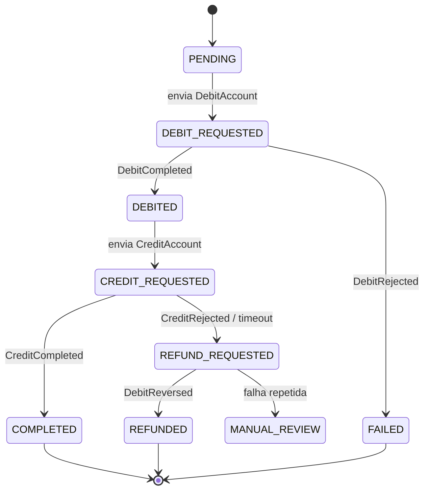

# transfer-service

Recebe pedidos de transferência (estilo PIX/TED) e **orquestra a Saga** que move o dinheiro entre duas contas, com compensação em caso de falha.

## 1. Por que este serviço existe

Uma transferência envolve duas contas e, em um sistema distribuído, **não existe transação ACID global**. Debitar e creditar são operações separadas, e qualquer uma pode falhar. Este serviço mantém o estado da transferência e decide o próximo passo (ou a compensação) a cada evento recebido.

## 2. Responsabilidades

- Expor `POST /transfers` com **idempotência** por `Idempotency-Key`
- Manter a **máquina de estados** da transferência
- Enviar comandos a `account-service` e reagir aos eventos de resposta
- Compensar (estornar) quando o crédito falha após o débito
- Detectar transferências "presas" (timeout) e resolvê-las
- Publicar o ciclo de vida da transferência em `transfer.events.v1`

## 3. Decisões técnicas e por quê

| Decisão | Alternativa descartada | Motivo |
|---|---|---|
| **Saga orquestrada** | Saga coreografada | Em um fluxo financeiro, ter **um lugar** que conhece o estado e o passo seguinte facilita auditoria, debug e timeouts. Na coreografia o fluxo fica espalhado entre serviços (ADR-002) |
| **Máquina de estados persistida** | Estado só em memória/eventos | Sobrevive a restart; permite consultar o status e retomar saga interrompida |
| **`Idempotency-Key` com constraint única** | Deduplicar só na aplicação | Cliente com timeout vai repetir o POST. A constraint do banco impede duas transferências do mesmo pedido |
| **Comandos via Kafka (assíncrono)** | REST síncrono para account-service | Resiliência: indisponibilidade temporária não derruba a requisição; o comando fica no tópico |
| **`POST /transfers` retorna `202 Accepted`** | Bloquear até concluir | A transferência é assíncrona por natureza; o cliente consulta `GET /transfers/{id}` |
| **Outbox** (igual ao account-service) | `kafkaTemplate.send` direto | Mudar o estado e emitir comando/evento precisa ser atômico |
| **Chave de `transfer.events.v1` = `sourceAccountId`** | `transferId` | Mantém a ordem por transferência e permite agregação por conta no fraud-service sem repartition |
| **Compensação semântica** (`ReverseDebit`) | Rollback "técnico" | Não dá para dar rollback em outro serviço; desfaz-se com uma operação de negócio |
| **Timeout via scheduler** | Esperar para sempre | Mensagem pode nunca chegar. Sem timeout, o dinheiro pode ficar "no limbo" |

## 4. Fluxo da Saga



| Estado | Significado | Terminal? |
|---|---|---|
| `PENDING` | Criada, ainda sem comando enviado | Não |
| `DEBIT_REQUESTED` | Aguardando resposta do débito | Não |
| `DEBITED` | Pagador debitado (dinheiro "em trânsito") | Não |
| `CREDIT_REQUESTED` | Aguardando resposta do crédito | Não |
| `COMPLETED` | Sucesso | Sim |
| `FAILED` | Rejeitada antes de mexer em dinheiro | Sim |
| `REFUND_REQUESTED` | Crédito falhou, estorno em andamento | Não |
| `REFUNDED` | Dinheiro devolvido ao pagador | Sim |
| `MANUAL_REVIEW` | Compensação falhou: intervenção humana | Sim (operacional) |

## 5. Eventos

### Produz
- **`account.commands.v1`** (chave `accountId`): `DebitAccount`, `CreditAccount`, `ReverseDebit`
- **`transfer.events.v1`** (chave `sourceAccountId`): `TransferRequested`, `TransferCompleted`, `TransferFailed`, `TransferRefunded`

### Consome
- **`account.events.v1`** (`groupId=transfer-service`): `DebitCompleted`, `DebitRejected`, `CreditCompleted`, `CreditRejected`, `DebitReversed`

> O consumer deve **ignorar eventos de transferências desconhecidas** e **eventos que não fazem sentido para o estado atual** (ex.: `CreditCompleted` de uma transferência já `REFUNDED`). Transição inválida = log + ack, nunca exceção.

## 6. Modelo de dados (PostgreSQL + Flyway)

```sql
CREATE TABLE transfers (
    id                      UUID PRIMARY KEY,
    idempotency_key         VARCHAR(64)    NOT NULL,
    source_account_id       UUID           NOT NULL,
    destination_account_id  UUID           NOT NULL,
    amount                  NUMERIC(19,2)  NOT NULL CHECK (amount > 0),
    currency                CHAR(3)        NOT NULL DEFAULT 'BRL',
    status                  VARCHAR(24)    NOT NULL,
    failure_reason          VARCHAR(80),
    request_hash            CHAR(64)       NOT NULL,   -- SHA-256 do corpo: detecta key reutilizada com payload diferente
    version                 BIGINT         NOT NULL DEFAULT 0,
    created_at              TIMESTAMPTZ    NOT NULL DEFAULT now(),
    updated_at              TIMESTAMPTZ    NOT NULL DEFAULT now(),
    deadline_at             TIMESTAMPTZ,               -- usado pelo job de timeout
    CONSTRAINT uq_transfer_idempotency UNIQUE (idempotency_key),
    CONSTRAINT ck_different_accounts CHECK (source_account_id <> destination_account_id)
);
CREATE INDEX idx_transfers_status_deadline ON transfers (status, deadline_at)
    WHERE status IN ('DEBIT_REQUESTED','CREDIT_REQUESTED','REFUND_REQUESTED');
CREATE INDEX idx_transfers_source ON transfers (source_account_id, created_at DESC);

-- histórico de cada passo da saga (auditoria e debug)
CREATE TABLE saga_steps (
    id           BIGSERIAL PRIMARY KEY,
    transfer_id  UUID         NOT NULL REFERENCES transfers(id),
    from_status  VARCHAR(24),
    to_status    VARCHAR(24)  NOT NULL,
    trigger      VARCHAR(80)  NOT NULL,        -- ex.: 'DebitCompleted', 'TIMEOUT', 'API'
    details      JSONB,
    created_at   TIMESTAMPTZ  NOT NULL DEFAULT now()
);
CREATE INDEX idx_saga_steps_transfer ON saga_steps (transfer_id, created_at);

CREATE TABLE processed_messages (
    message_id     UUID         NOT NULL,
    consumer_name  VARCHAR(80)  NOT NULL,
    processed_at   TIMESTAMPTZ  NOT NULL DEFAULT now(),
    PRIMARY KEY (message_id, consumer_name)
);

CREATE TABLE outbox_events (
    id             UUID PRIMARY KEY,
    aggregate_type VARCHAR(40)  NOT NULL,
    aggregate_id   VARCHAR(64)  NOT NULL,
    event_type     VARCHAR(80)  NOT NULL,
    topic          VARCHAR(120) NOT NULL,
    payload        BYTEA        NOT NULL,
    headers        JSONB        NOT NULL DEFAULT '{}',
    created_at     TIMESTAMPTZ  NOT NULL DEFAULT now(),
    published_at   TIMESTAMPTZ
);
CREATE INDEX idx_outbox_pending ON outbox_events (created_at) WHERE published_at IS NULL;
```

**Por que `saga_steps`?** Responde "o que aconteceu com minha transferência?" sem precisar vasculhar logs, e é ótimo para demonstrar em entrevista.
**Por que `request_hash`?** Se o cliente reusar a mesma `Idempotency-Key` com valor diferente, é bug ou fraude: responder `422` em vez de devolver a transferência antiga.

## 7. API REST

| Método | Rota | Descrição |
|---|---|---|
| `POST` | `/transfers` | Header obrigatório `Idempotency-Key`. Retorna `202` com `transferId`. Repetição com mesma key e mesmo corpo retorna a transferência existente |
| `GET` | `/transfers/{id}` | Status atual e motivo de falha |
| `GET` | `/transfers/{id}/history` | Passos da saga (`saga_steps`) |

## 8. Etapas de implementação

### Etapa 1: API e persistência (Fase 1)
- Projeto Spring Boot, migration `transfers`
- `POST /transfers` com `Idempotency-Key` e validações (valor > 0, contas diferentes)
- Tratar corrida: duas requisições simultâneas com a mesma key → uma cria, outra recebe a existente (capturar `DataIntegrityViolationException`)
- **Pronto quando:** repetir o POST 5× cria uma só transferência

### Etapa 2: Comando de débito e resposta (Fase 1)
- Publicar `DebitAccount` (chave = `sourceAccountId`) e mover para `DEBIT_REQUESTED`
- Consumir `account.events.v1` e tratar `DebitCompleted`/`DebitRejected`
- **Conceito:** comunicação assíncrona request/reply via tópicos, correlação por `transferId`
- **Pronto quando:** transferência vai de `PENDING` a `DEBITED` ou `FAILED`

### Etapa 3: Máquina de estados explícita (Fase 1/2)
- Classe `TransferStateMachine` com tabela de transições válidas (ou Spring Statemachine, se quiser)
- Registrar cada transição em `saga_steps`
- Transição inválida → ignorar com log
- **Pronto quando:** testes unitários cobrem todas as transições válidas e inválidas

### Etapa 4: Fluxo feliz completo (Fase 2)
- Após `DebitCompleted`, enviar `CreditAccount` (chave = `destinationAccountId`)
- `CreditCompleted` → `COMPLETED` + `TransferCompleted`
- Migrar contratos para Avro
- **Pronto quando:** transferência ponta a ponta funciona e aparece no Kafka UI

### Etapa 5: Idempotência e Outbox (Fase 3)
- Mudança de estado + `saga_steps` + `outbox_events` + `processed_messages` na **mesma transação**
- Publisher do outbox igual ao do account-service (extraia para uma lib comum se quiser)
- **Pronto quando:** teste de caos (matar o serviço no meio) não deixa transferência inconsistente

### Etapa 6: Compensação (Fase 4)
- `CreditRejected` → `REFUND_REQUESTED` + `ReverseDebit`
- `DebitReversed` → `REFUNDED` + `TransferRefunded`
- **Pronto quando:** teste com conta destino inexistente termina em `REFUNDED` e o saldo do pagador volta ao original

### Etapa 7: Timeouts (Fase 4)
- Job agendado (`@Scheduled` + `SELECT ... FOR UPDATE SKIP LOCKED`) busca transferências com `deadline_at` vencido
- `DEBIT_REQUESTED` vencida: reenviar o comando (idempotente no account-service) ou falhar após N tentativas
- `CREDIT_REQUESTED` vencida: reenviar; esgotadas as tentativas, estornar
- `REFUND_REQUESTED` que não resolve: `MANUAL_REVIEW` + alerta
- **Conceito:** sistemas distribuídos precisam tratar a **ausência** de resposta
- **Pronto quando:** derrubar o account-service durante a saga não deixa nenhuma transferência presa para sempre

### Etapa 8: Testes de falha (Fase 6)
- Cenários com Testcontainers: saldo insuficiente, conta bloqueada, crédito rejeitado, evento duplicado, evento fora de ordem, consumer reiniciado
- **Pronto quando:** todos os cenários têm teste automatizado, rodando no CI

### Etapa 9: Observabilidade (Fase 6)
- Métricas: transferências por status, duração fim a fim, contagem de `MANUAL_REVIEW`
- `correlationId` = `transferId` em logs (MDC) e traces
- **Pronto quando:** consigo seguir uma transferência no trace do início ao fim

## 9. Estrutura de pacotes sugerida

```
com.exemplo.transfer
├── api/
├── application/     (CreateTransfer, HandleAccountEvent, TimeoutSweeper)
├── domain/          (Transfer, TransferStatus, TransferStateMachine)
└── infrastructure/
    ├── persistence/
    ├── messaging/   (listeners, OutboxPublisher, mapeadores Avro)
    └── config/
```

## 10. Perguntas de entrevista que este serviço responde

- *Como funciona uma transação distribuída sem 2PC?* → Saga com compensação.
- *Orquestração ou coreografia, e por quê?* → Orquestrada: estado centralizado, mais fácil de auditar e aplicar timeout.
- *E se a compensação também falhar?* → Retry idempotente e, esgotado, `MANUAL_REVIEW` com alerta.
- *Como evitar transferência duplicada se o cliente reenviar a requisição?* → `Idempotency-Key` + constraint única + `request_hash`.
- *O que acontece com mensagens fora de ordem ou duplicadas?* → Máquina de estados ignora transições inválidas; dedupe por `eventId`.
- *Por que 202 e não 200?* → O processamento é assíncrono; a resposta confirma o recebimento, não a conclusão.
